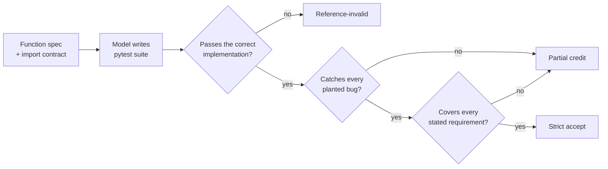

# Qwenny: can a small local fine-tune make a 9B model write better tests?

An open, pre-registered research log on fine-tuning **Qwen3.5-9B** with **QLoRA on a single consumer GPU (RTX 3080, 10 GB)**. The goal is to make the model more reliable at a narrow, checkable skill: writing a correct `pytest` suite from a precise function specification.

> **Status: active (November 2026).** Local training works end to end. No improvement in answer quality has been shown yet, and no fine-tuned model has been selected. The held-out final and regression tests remain sealed. This repository is a snapshot of the working folder; see [PUBLICATION_NOTES.md](PUBLICATION_NOTES.md).

---

## Why this project is worth a look

Most fine-tuning demos report a training-loss curve and stop there. This project asks a harder question, *"does the fine-tuned model actually produce better answers?"*, and treats measurement as the main engineering problem.

- **Scored by running code, not by eye.** Every task has a hidden correct implementation and planted-bug variants ("mutants"). A generated test suite only counts if it passes the correct code **and** catches the planted bugs through real assertions.
- **Decided before the data came in.** Each study freezes its question, inputs, settings and scoring rules (with SHA-256 manifests) before any model output exists. Failed and unfinished attempts are kept, never retried or cherry-picked.
- **Leak-proof splits.** Training, development, final and regression tasks are split by problem family. The final and regression sets have never been opened, and they are **not published here** so they stay unseen.
- **Honest negative results.** Six studies in, "0 answers fully accepted" is reported as plainly as any success would be, along with exactly what *did* work.
- **Self-correction on the record.** An independent adversarial review found that several of the project's own gold answers failed its own grading rubric. The finding was confirmed, published as a correction ([Report 003](observer/REPORT_003.md)), and the measuring system was rebuilt and recalibrated (S007). The original results were left unchanged.

## The question

> Can a small LoRA adapter make the model more reliable at writing Python tests than a strong prompt with examples?

The planned comparison is: base model + instructions (A), base + two worked examples (B), and base + LoRA adapter (C). The bar for adopting an adapter, set before any final test, is at least **+10 percentage points** over B on the held-out tasks, with no extra regressions and no rise in made-up "I ran the tests" claims. See [01_EXPERIMENT_PLAN.md](01_EXPERIMENT_PLAN.md).

## Results so far

| Study | Question | Finding |
|---|---|---|
| S001 | Do two worked examples in the prompt help? | No first-attempt benefit (two-task pilot). |
| S002 | Can a 9B model be QLoRA-trained and reloaded on a 10 GB GPU? | **Yes.** 2,048-token training fits with 4-bit (NF4) weights and the input embeddings kept on the CPU. Checkpoints reload and give identical outputs. |
| S003 | Do decoding settings explain the gap between training loss and answer quality? | No. The tested settings produced no strictly accepted answers. |
| S004 | Does a shorter answer format help? | No. Both pilot answers were invalid Python. |
| S005 | Does letting the model "think" first help? | No (0/2 per arm). Five of six answers hit the 8,192-token limit while still reasoning. |
| S006 | Does failure show up even on tasks the model trained on? | Yes. All 24 answers finished; 8 passed the correct code, 5 caught every planted bug, 0 were strictly accepted. Later review showed this strict score is not a calibrated capability measure ([Report 003](observer/REPORT_003.md)). |
| S007 | Can the grading system be repaired? | **Yes.** 72 gold suites (1,475 test cases) and 407 planted-bug versions pass recalibration; five deliberately bad answers are correctly rejected. |
| S008 | Can the models compute the expected return values on their own, with no tests to write? | Partly. The base model got 22/32 values right, epoch-1 adapter 23/32, epoch-5 adapter 22/32. Accuracy is clearly lower on development tasks (9–10/16) than on training tasks (12–14/16). |
| S009 | Do short, verified calculation notes in the training answers (e.g. `1*3+2 = 5`) help? | **Unanswered.** Data, scorer and hardware checks all passed, but the first training run slowed sharply as GPU memory ran out and stopped at its declared 20-minute limit. The second run was not started, and the result was not guessed. |

Full register: [program/STUDY_REGISTER.md](program/STUDY_REGISTER.md). Plain-language reports: [observer/](observer/), starting with the [glossary](observer/GLOSSARY.md).

## What has been learned

1. **Lower training loss did not produce better answers.** The adapters learned to predict the reference answers, but their own freely written answers were not more reliable.
2. **Many failures are wrong arithmetic, not wrong syntax.** Wrong offsets, distances and neighbour lists show up even on familiar tasks (S006, S008). That led directly to the calculation-notes idea in S009.
3. **The grader needs testing as much as the model does.** Gold answers must satisfy the same rubric used to judge the model. A grader can be checked the same way a model is: by running deliberately broken implementations against the gold suites.
4. **Consumer-hardware limits are real and measurable.** S009's slowdown coincided with GPU free memory reaching zero. That is recorded as an observed association to investigate, not as a diagnosed cause.

## Stack

| | |
|---|---|
| Base model | Qwen3.5-9B, pinned revision `c202236235762e1c871ad0ccb60c8ee5ba337b9a` |
| Training | QLoRA: `transformers` 5.22.1, `peft` 0.21.2, `bitsandbytes` 0.50.2, `accelerate` 1.15.0; 4-bit (NF4) base weights, input embeddings on the CPU, 2,048-token context |
| Hardware | One NVIDIA RTX 3080 (10 GB VRAM), Windows; everything runs locally, nothing in the cloud |
| Evaluation | Python 3.15, pytest 9.2; each answer tested in isolation with plugins disabled, a 20-second timeout and planted-bug ("mutant") checks |

## Repository map

The folder layout is kept exactly as in the working project, so every cross-link and hash manifest stays valid.

| Path | Contents |
|---|---|
| [START_HERE.md](START_HERE.md) | The project's own current entry point and reading order |
| [program/](program/) | Current state, study register, decision log, roles and workflow, reviews and handoffs |
| [observer/](observer/) | Plain-language reports (001–006) and glossary |
| [studies/](studies/) | S006–S009: frozen protocols, inputs, results, interpretations, scorers and integrity manifests |
| [dataset-v1/](dataset-v1/) | Task builder, validators and candidate datasets (training and development tasks only) |
| [training-v1/](training-v1/) | Training, probing and scoring code; S002–S005 results; generation probes and execution logs |
| [lora-feasibility/](lora-feasibility/) | GPU memory-fit and timing trials that established local training |
| [prompt-comparison/](prompt-comparison/), [pilot/](pilot/), [runs/](runs/) | Early prompt-only experiments (S001) |
| `01_`–`06_*.md`, `HANDOFF_*.md` | Original protocol documents and stage handoffs, kept as historical evidence |
| [README_ORIGINAL.md](README_ORIGINAL.md) | The project's original introduction, unchanged |

## How this project is run

This is an AI-assisted research project, and the roles are disclosed openly:

- **Direction, review and approval:** [@TronBronson1](https://github.com/TronBronson1). Sets the research question, approves each study and each training run, and decides what gets published.
- **Experiment execution and documentation:** an OpenAI ChatGPT/Codex agent acting as orchestrator, working under the written governance in [program/ROLES_AND_WORKFLOW.md](program/ROLES_AND_WORKFLOW.md).
- **Independent adversarial review:** Anthropic Claude (Claude Code) reviews task wording, prompts and scoring. Its review prompted the S006 correction and the S007 measurement repair ([program/reviews/](program/reviews/)).

Ground rules followed throughout: freeze everything before running, keep every attempt, never train on failed answers, never repair an answer inside its first-attempt score, and keep the final tests sealed.

## License

- **Code** (`*.py`, `*.ps1`): [MIT](LICENSE)
- **Documentation, reports, results and task data:** [CC BY 4.0](LICENSE-docs.md). Reuse is welcome with attribution.
- **Third-party:** Qwen3.5-9B metadata in `lora-feasibility/upstream-metadata/` stays under Apache 2.0.
